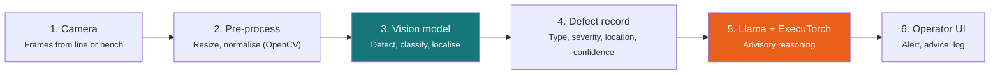
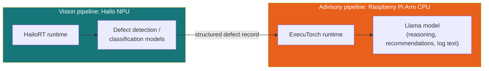

# Problem Statement 5: Real-Time Industrial Defect Detection & Quality Control Assistant

> **In short:** Build an **edge-deployed visual inspection system** that detects surface defects, evaluates their severity, and recommends corrective action to operators, **without relying on the cloud**.

---

## 1. The Challenge: Build an On-Device Quality Inspector

### Objective

Develop an **on-device AI system** that performs **real-time visual inspection** of manufactured components, detects surface defects and anomalies, and assists quality-control operators.

### Core Capabilities (all five are required)

| # | Capability | What it means |
|---|------------|---------------|
| 1 | **Detect** | Surface defects, cracks and anomalies |
| 2 | **Classify** | Defect type and severity |
| 3 | **Alert** | Operator alerts with actionable advice |
| 4 | **Log** | Structured record of every inspection |
| 5 | **Run at the edge** | Real-time, no cloud dependence |

---

## 2. Domains and Hardware: Where It Applies and What It Runs On

### Application Areas

You can pick **any** manufacturing domain, for example:

| | |
|---|---|
| PCB inspection | Steel and metal surfaces |
| Textile and fabric | Packaging integrity |
| Automotive components | Pharma tablets and capsules |

### Supported Hardware

| Platform | Notes |
|----------|-------|
| **Raspberry Pi 5** | CPU-only |
| **Raspberry Pi 5 + AI HAT+ / AI HAT+ 2** | Hailo NPU for vision |
| **Arm-based Linux devices** | |
| **Arm-based Android devices** | With camera |

---

## 3. System Design: Reference Architecture



| Stage | Component | Role |
|-------|-----------|------|
| 1 | **Camera** | Captures frames from the production line or an inspection bench |
| 2 | **Pre-process** | Resize, normalise (OpenCV) |
| 3 | **Vision model** | Detect, classify and localise defects |
| 4 | **Defect record** | Structured output: type, severity, location, confidence |
| 5 | **Llama + ExecuTorch** | Advisory reasoning: explains the defect and suggests actions |
| 6 | **Operator UI** | Delivers the alert, advice and log entry to the operator |

> **💡 Design hint:** Give Llama **structured findings** (defect class, severity, location, confidence), **not raw pixels**. Llama explains the defect, suggests actions and writes the log entry.

**Example defect record** (illustrative only, not prescribed by the brief):

```json
{
  "defect_class": "scratch",
  "severity": "high",
  "location": { "x": 212, "y": 148, "w": 64, "h": 22 },
  "confidence": 0.91
}
```

---

## 4. Hailo Accelerator Option: Two Separate Pipelines. Document Both.

When a Hailo accelerator is used, the system runs as **two distinct pipelines** on two different compute units. The technical report **must document them clearly and separately**.



| | **Vision pipeline** (Hailo NPU) | **Advisory pipeline** (Raspberry Pi Arm CPU) |
|---|---|---|
| Runtime | Runs through **HailoRT** | **Llama** model via **ExecuTorch** |
| Executes on | The **Hailo NPU** | The **Arm CPU** |
| Responsibility | Defect detection / classification models | Reasoning, recommendations, log text |
| Applicability | Used with AI HAT+ / AI HAT+ 2 | **Required in every submission** |

> Without a Hailo accelerator, the vision model can also run on the Pi CPU. **Keep the two runtimes clearly separated in the report.**

---

## 5. Tools and Data: Technology Stack and Starter Datasets

### Required

| Component | Purpose |
|-----------|---------|
| **Llama + ExecuTorch** | A Llama-family model for advisory reasoning, deployed on-device with **ExecuTorch as the reference runtime** |

### Optional

| Tool | Purpose |
|------|---------|
| **OpenCV** | Capture and pre-processing |
| **Hailo SDK** | Run vision models on the NPU |
| **YOLO / EfficientDet** | Detection models |
| **Anomaly detection frameworks** | For settings with few defect samples |

### Starter Datasets

| Dataset | Description |
|---------|-------------|
| **MVTec AD** | Anomaly detection across 15 object and texture categories |
| **NEU Surface Defect** | Steel surface defects in 6 classes (e.g. crazing, scratches) |
| **KolektorSDD** | Surface cracks on electrical commutators |

---

## 6. Submission: Deliverables and What Good Looks Like

### Deliverables

| # | Deliverable | Expectation |
|---|-------------|-------------|
| 1 | **Source code** | Runnable, documented |
| 2 | **Application** | Working on the target device |
| 3 | **Demo video** | Shows detection, alerts, logging |
| 4 | **Technical report** | Design, runtimes, results, limits |

### Suggested Evaluation Lens

| Criterion | What is assessed |
|-----------|------------------|
| **Detection quality** | Misses vs. false alarms |
| **Real-time on device** | Measured latency, FPS |
| **Useful advice** | Grounded in findings |
| **Operator UX** | Clear alerts, easy-to-read log |
| **Rigour** | Both runtimes documented |

---

## 7. Key Constraints at a Glance

- ✅ **Fully on-device / edge.** No cloud dependence at any stage.
- ✅ **Real-time** inspection with measured latency and FPS.
- ✅ **Llama + ExecuTorch are mandatory** for the advisory reasoning layer.
- ✅ Feed the LLM **structured defect records**, not raw images.
- ✅ **Every inspection must be logged** as a structured record.
- ✅ If using Hailo: **vision on the NPU (HailoRT) and Llama on the Arm CPU (ExecuTorch)**, documented as two separate pipelines.

---

*Source: AIBharat Problem Statement 5 (PS5 video transcript and presentation slides).*
