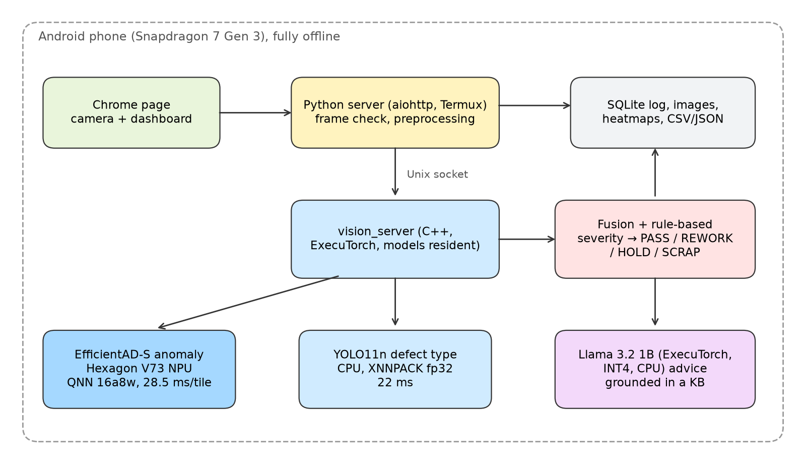
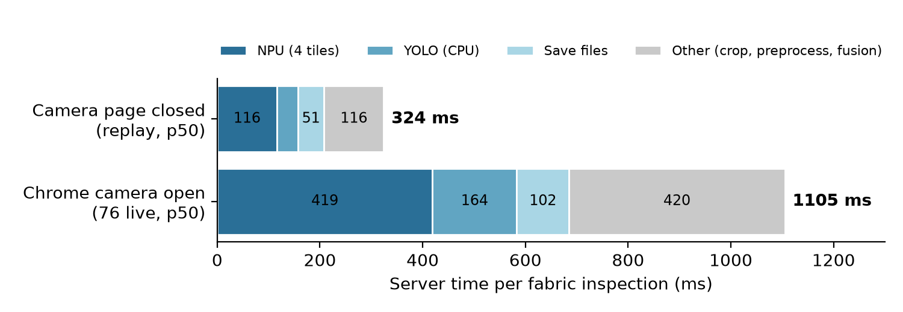

# Edge Quality Inspector: On-Device Industrial Defect Detection and QC Advice on a Snapdragon Phone

**AIBharat Bharat AI-SoC Student Challenge, Problem Statement 5. Final technical report, 24 November 2026.**

## Abstract
We built a quality-control station that runs entirely on one Android phone (Snapdragon 7 Gen 3). The operator places an item under the phone on a fixed stand and presses **Inspect**. The phone then detects and localises defects, classifies their severity, gives a verdict (PASS / REWORK / HOLD / SCRAP), logs the inspection, raises an audible alert, and generates corrective-action advice with an on-device large language model. No network connection is used.

The vision pipeline uses an **EfficientAD-S anomaly model on the Hexagon V73 NPU** (ExecuTorch, QNN backend, 16-bit activations / 8-bit weights), which runs in **28.5 ms per 256 px tile**, about 50× faster than the same model on the CPU. A **YOLO11n detector** on the CPU (ExecuTorch, XNNPACK) names known defect types. The advisory pipeline runs **Llama 3.2 1B Instruct** (ExecuTorch, SpinQuant INT4) on the CPU, grounded in a hand-written knowledge base. Every live answer was valid JSON citing only knowledge-base actions.

On the demo fabric the quantised NPU model loses only 0.001 image AUROC against fp32. After a quantisation fix found on the device (§5.4), small cuts score 3-6× above good material on the phone's NPU. With the camera page closed an inspection takes 0.33 s of server time. With Chrome's camera running beside it, it takes 1.1 s (p50), which we report as the main open performance issue.

---

## 1. Problem and goals
Problem Statement 5 asks for an edge AI system that inspects industrial products, detects and localises defects, classifies their severity, alerts an operator, logs results, and explains them through an LLM-based advisory pipeline, using **Llama** and **ExecuTorch** on an AI-capable SoC.

| Requirement | How it is met |
|---|---|
| Real-time defect detection and localisation | EfficientAD-S heatmap (NPU) + YOLO11n boxes (CPU), fused into defect regions |
| Severity classification | Deterministic rules (type, size, strength) → LOW / MEDIUM / HIGH / CRITICAL → disposition |
| Operator alerts | Colour verdict banner, sound pattern per verdict, vibration, acknowledge button |
| Logging | SQLite on the phone: record, image, heatmap, defect crops; CSV / JSON export |
| LLM advisory | Llama 3.2 1B (ExecuTorch) turns the inspection record into a summary, probable cause and actions from a knowledge base |
| Edge only | Everything runs on the phone: browser page, Python server, native ExecuTorch runtimes |

**Design principle:** the *verdict* never depends on the LLM. Severity is computed by rules, so the alert is instant and repeatable. Llama explains the verdict afterwards and cannot change it (ADR-006, ADR-007).

## 2. Hardware platform
| | |
|---|---|
| Device | OnePlus CPH2613, **Snapdragon 7 Gen 3 (SM7550)**, Android 14, 8 GB RAM |
| CPU | 4 × Cortex-A715 + 4 × Cortex-A510 (Armv9, i8mm, bf16) |
| NPU | **Hexagon V73**, 2 MB VTCM (confirmed on the device with Qualcomm's `qnn-platform-validator`) |
| Runtime | ExecuTorch v1.5.0 (QNN backend with QAIRT 2.37, XNNPACK backend), built with Android NDK r28c |
| Host environment | Termux (Python 3.14, aiohttp, NumPy, Pillow, OpenCV); Chrome for camera and UI |
| Training machine | Laptop with an RTX 4050 GPU (WSL 2) |

**Making the NPU usable.** SM7550 is not in ExecuTorch's supported chip list. Instead of assuming "not supported", we compiled test models for a stand-in chip of every Hexagon generation and ran them on the phone (ADR-012). Only contexts compiled for **SSG2115P** (also V73 with 2 MB VTCM) load, and their outputs match the CPU reference. The NPU is reachable only from processes started inside the Termux app (with `/vendor/lib64` on the library path), not from `adb shell run-as`. The app is started there by a one-tap script.

## 3. System architecture

1. **Chrome page** (`edge/web/index.html`): live preview with a framing square, Calibrate / Teach good / Inspect buttons, verdict banner, sound and vibration, log, statistics. It sends one full-resolution frame (3072 × 4096) plus the square's position when the operator presses Inspect (button trigger, fixed stand: ADR-020).
2. **Python server** (`edge/app/`, aiohttp on `localhost:8000`): frame check, preprocessing, fusion, severity, logging, advice queue.
3. **vision_server** (`edge/vision_server/`, C++, ADR-022): loads every model **once** and keeps it resident, then serves inference requests over a Unix socket with a zero-copy client. Starting a runner per frame would reload the model for 0.2-0.4 s each time.
4. **Advice worker** (`edge/app/advisor/`): a background thread that runs `llama_main` (ExecuTorch) at lower CPU priority. It never blocks inspection.

Two separate pipelines run on separate compute units, as the brief's reference design suggests: **vision on the NPU** (plus a small CPU detector), **Llama on the CPU**.

## 4. Data
| Source | Use | Size |
|---|---|---|
| **MVTec AD** (9 categories: cable, carpet, grid, leather, metal_nut, screw, tile, transistor, wood; CC BY-NC-SA 4.0) | YOLO training (48 classes), anomaly benchmarks, replay mode | YOLO: 811 train / 181 val / 296 test images, 996 boxes |
| **Own photos**, light wood board and looped fabric (towel), captured with the phone on a stand | Demo products: anomaly training (good only), YOLO own classes, test sets | Fabric: 65 train / 20 val / 20 good + 85 defect test (colour, cut, hole, thread); wood: 35 / 5 / 15 + 51 |
| **"Teach normal"** photos from the actual station | Retraining the fabric anomaly model for live conditions | 60 good frames per teach session |

Defects were made by hand (dye marks, holes, cuts, pulled threads) and labelled in Label Studio. Splits are by capture burst, so near-identical frames never fall on both sides of a split (ADR-017). Full details are in `docs/data/DATASET.md`.

## 5. Methodology: vision pipeline

### 5.1 Hybrid detection (ADR-005)
- **EfficientAD-S** (Batzner et al., WACV 2024) learns only from **good** samples and flags *anything* unusual, with a pixel heatmap for localisation. This matters because real defects are rare and varied.
  - Teacher / student / autoencoder networks (PDN-small).
  - Training: 70,000 iterations for benchmark models, 20,000 for station retraining; Adam, ImageNet penalty, hard-feature loss; bf16 on the GPU.
  - **Fabric uses 2 × 2 tiles**: the capture square is resized to 512 px and scored as four 256 px tiles. The image score is the maximum of the stitched map. Without tiling, thin cuts and threads disappeared (P-57).
- **YOLO11n** (Ultralytics), 320 px, fine-tuned on MVTec plus own photos, 48 classes. It **names** defects it recognises (e.g. `fabric_color`).
- **Fusion** (`edge/app/pipeline/fusion.py`): the anomaly map is thresholded into connected regions. Regions are trimmed to 25% of their peak, nearby regions are merged, and the region holding the image maximum is always kept (P-73). Each region is then matched to YOLO boxes by IoU:
  - matched → a typed defect;
  - unmatched region → `unknown_anomaly`;
  - a YOLO box without anomaly support → a **note** that never changes the verdict.

### 5.2 Severity and verdict (ADR-006, `edge/config/severity.toml`)
- `level = base level of the defect type`, +1 if the defect is large (≥ 2% of the square), +1 if it is strong (peak ≥ 10 × the calibrated threshold), capped at CRITICAL.
- A per-type cap applies: colour marks are cleanable, so they never exceed MEDIUM.
- The item takes its worst defect. Disposition mapping: LOW/MEDIUM → REWORK, HIGH → HOLD, CRITICAL → SCRAP, none → PASS.
- Every level carries its human-readable reasons, which are shown on screen and stored in the log. The rules are covered by unit tests.

### 5.3 Station adaptation: calibration, frame check, teach
Laboratory thresholds did not transfer to live conditions: lighting, camera white balance and distance all shift the anomaly scores (P-56, P-68, P-69). Three mechanisms handle this:
1. **Per-product calibration** (ADR-021). The operator shows 20 good frames, moving the item to a new spot every 5 frames. The threshold is `p99 + max(std, 10% of p99)` of the deployed NPU model's own scores. It is stored with the model's identity, so a retrained model forces a new calibration (P-71).
2. **Frame check** (P-68). Too-dark frames and fabric at the wrong distance (measured from the texture period of the loops) are answered with "retake" and are not judged or logged.
3. **Teach normal** (P-69). The operator captures 60 good frames at the station. One laptop script (`training/vision/runs/teach_retrain.sh`) pulls them, splits them by burst, retrains, evaluates, exports for the NPU, pushes the model to the phone and updates the configuration. This is the standard industrial workflow and fixed the domain shift that colour matching could not (good live frames had scored 3-9 against a training level of 0.2).

### 5.4 Quantisation for the NPU
- PT2E quantisation with the QNN quantizer, per-channel 8-bit weights, compiled for SSG2115P.
- **16-bit activations (16a8w) are required.** At 8a8w the tiny student-teacher differences of normal images are lost.
- **Calibration data design** was the key problem:
  - **Good images only** → output collapsed to a constant. Calibration batches now include synthetic defects (P-59).
  - **Real small defects were still clipped** (P-74). A stage-by-stage trace on a cut showed teacher features reaching 8.8 while the quantised graph capped them at 6.06, the largest value seen in calibration. On the phone, cut scores were compressed 2-4× into the range of good material.
  - Widening every activation range by editing the observers worked in simulation, but returned **0.0 for every image on the real NPU**. The QNN quantizer links some ranges, and the compiled graph does not tolerate broken links.
  - **Working fix:** 25% extra calibration tiles that are good tiles with contrast boosted 6×. These push every layer to defect-like magnitudes through normal calibration, so the linked ranges stay consistent.
  - Verified **on the phone**: cuts 0.24 → 0.79, 0.33 → 0.80, 0.40 → 0.62; good towel 0.17 → 0.12. NPU time is unchanged.
- **YOLO stays fp32 on the CPU.** Its class scores collapsed under QNN quantisation at every precision tried (P-62), and at 22 ms it does not need the NPU.

### 5.5 Preprocessing parity
The phone uses **the same Pillow resize as training**. An OpenCV `INTER_AREA` resize looked equivalent but cut fabric AUROC from 0.918 to 0.877 (P-63). With Pillow, phone inputs are bit-identical to training inputs (`edge/scripts/parity_preprocess.py`).

## 6. Methodology: advisory pipeline (Llama 3.2 1B on ExecuTorch)
- **Model:** Llama 3.2 1B Instruct, Meta's SpinQuant INT4 ExecuTorch export (1.14 GB `.pte`), run by ExecuTorch's `llama_main` (XNNPACK, 4 threads).
- **Knowledge base** (`edge/config/kb/*.toml`): for each defect type, typical causes and numbered actions (e.g. `F-H1`).
- **Prompt:** Llama-3 chat format; system rules; the inspection record (verdict-driving defects only, at most 3); KB entries for those types. The answer is pre-filled with `{"summary": "`. Without the pre-fill the model answered in Markdown.
- **Validation:**
  1. JSON extraction with repair, plus a Markdown parser as a safety net;
  2. **grounding**: only action ids from the KB entries of *this record's* defect types are kept (in testing Llama once cited a wood action for a fabric cut, and grounding removed it);
  3. if nothing valid remains, a templated fallback is used.
- **Never blocking:** the template advice is stored instantly with the inspection, and the LLM version replaces it when ready. The worker processes only the **newest** waiting inspection, runs at `nice 10` so inspections take priority, and caps output at 140 tokens.

## 7. Operator application
- **Inspect tab:** big INSPECT button; verdict banner (green / amber / red); sound pattern per verdict (Web Audio, works offline) and vibration; defect table with reasons; image / heatmap toggle; Acknowledge with an optional note; advice panel; a speed bar showing time per stage.
- **Log tab:** filters, paging, acknowledgement status, reopen any inspection; CSV / JSON export.
- **Stats tab:** inspections, pass rate, open alerts, average time, verdict and defect-type breakdown (today or all time).
- **One-tap start:** `start_inspector.sh` starts the server (and the vision server) in the background from the Termux app, waits until it answers, and opens Chrome on the page.

## 8. Results

### 8.1 Detection quality (held-out test sets, fp32; threshold = 99th percentile of validation-good scores)
| Model | Image AUROC | False alarms (good) | Recall (defects) | Notes |
|---|---|---|---|---|
| Own fabric (2×2 tiles) | **0.920** | 0/20 | 68/85 | colour 20/20, cut 20/20, hole 15/15, **thread 13/30** |
| Own wood | **1.000** | 1/15 | 51/51 | optimistic: one board, few sessions |
| MVTec carpet | **0.999** (pixel 0.986) | 12/28 | 89/89 | threshold transfer problem → calibration (§5.3) |
| MVTec wood | 0.976 (pixel 0.874) | 2/19 | 52/60 | |

YOLO11n reaches mAP50 0.728 on the MVTec test set and 0.376 on our own photos (72 images, one physical defect per class). Live, YOLO rarely names fabric defects, so the anomaly model does most of the detection and most live defects are reported as `unknown_anomaly`.

### 8.2 Quantisation (16a8w vs fp32, same data and protocol)
| Model | fp32 AUROC | 16a8w AUROC | Δ |
|---|---|---|---|
| Own fabric | 0.918 | 0.917 | −0.001 |
| Own wood | 1.000 | 1.000 | 0.000 |
| MVTec carpet | 0.998 | 0.9996 | +0.001 |
| MVTec wood | 0.975 | 0.945 | −0.030 (not used in the demo) |

**Phone replay** (full pipeline on the phone over the test photos): fabric AUROC **0.914** vs 0.917 on the laptop, and wood 1.000 vs 1.000. Both are within the 0.01 acceptance limit.

### 8.3 Live results on the stand (fabric)
We ran 76 live fabric inspections in a series of sessions on 24 November. Each session exposed a problem that changed the system:

| Session | Change being tested | Outcome |
|---|---|---|
| 1 | first live run | colour mark found; camera distance varied 3× and a black frame was judged → **frame check** (P-68) |
| 2 | fixed height | good frames scored 3-9 (camera colour shift) → **teach normal** (P-69) |
| 3 | taught model | holes 2/2, colour 3/3; a small cut missed; daylight drift (P-70) |
| 4 | closer camera, newest-session teach | 6/6 defects flagged; 2 false alarms from a too-narrow calibration (P-72) |
| 5 | varied calibration | colour found, but small cuts and threads passed → **NPU clipping** found (P-73, P-74) |
| later sessions | contrast-boosted quantisation | **cuts 0.62-0.80 vs good 0.12** on the NPU; remaining false alarms traced to lamp glare in one corner |

The current state: **colour marks, holes and small cuts are detected and localised live**. Thin pulled threads are borderline: they score like normal loop texture, the same limitation as in the offline results (13/30).

### 8.4 Latency
| Stage (on the phone) | Time |
|---|---|
| EfficientAD-S, one 256 px tile, NPU | **28.5 ms** (28.2-29.1 ms over check runs) |
| Same model on the CPU (XNNPACK fp32) | 1,419 ms |
| YOLO11n 320 px, CPU (XNNPACK fp32) | 22 ms compute, 27 ms with IPC |
| vision_server IPC overhead | ~6 ms (zero-copy; was 14 ms) |
| **Fabric inspection, server time, camera page closed** (replay, 4 tiles) | **324 ms p50 / 339 ms p95** |
| Wood inspection, same conditions (1 tile) | 185 ms p50 / 207 ms p95 |
| **Fabric inspection, live, Chrome camera open** (76 inspections) | **1,105 ms p50 / 1,840 ms p95** |
| Llama: model load / prefill / decode (idle) | 3.4 s / 144 tok/s / 12.3-13.3 tok/s |
| Llama advice, end to end, idle | **11.4 s** |
| Llama advice, alongside the live camera (22 answers) | 48 s average (11-91 s) |

The main performance finding is **contention with the camera**. While Chrome holds the camera in the foreground, every process in Termux slows down 2-6×, including NPU calls: 4 tiles take ~420 ms instead of 116 ms. Thermal status stays 0, so this is not thermal throttling. The same image runs at normal speed when the page is closed (P-68). Inspection still completes in about 1 s (target ≤ 1 s, p50) and the verdict and alert appear immediately; only the LLM advice is delayed.

### 8.5 Advice quality (live log)
- **22 of 22** Llama answers produced in live sessions were valid JSON (after repair) with **at least one grounded KB action**. No Llama output was rejected and replaced by the template.
- 3 queued requests were skipped by design because a newer inspection was waiting. Those records, and records that were never sent to Llama, kept the instant template advice.
- Not yet done: the planned manual 1-5 usefulness rating.
- Content is correct but often generic, because most live defects are `unknown_anomaly` (YOLO rarely names them), which maps to general actions ("smooth the fabric, remove lint, inspect again; if real, set aside for QC").

## 9. Hardware utilisation
| Unit | Work | Notes |
|---|---|---|
| **Hexagon V73 NPU** | EfficientAD-S anomaly model, 16a8w, 1 run per wood item, 4 per fabric item | 146 of 147 graph nodes delegated to the NPU; ~116 ms of NPU time per fabric inspection |
| **CPU, big cores** (XNNPACK) | YOLO11n fp32; Llama 3.2 1B INT4 (4 threads, `nice 10`) | Llama decode 12-13 tok/s; YOLO 22 ms |
| CPU (Python) | frame check, resize, fusion, severity, SQLite, HTTP | ~100-200 ms per inspection |
| **Memory** | vision_server 37 MB RSS (all models resident, flat over 1,000 calls); Llama peak 1.38 GB | fits in 8 GB together with Chrome |
| **Storage** | anomaly model 8.7 MB per product; YOLO ~10 MB; Llama 1.14 GB | |

The split follows the brief's reference design: the heavy, fixed-shape vision model goes to the NPU, and the autoregressive LLM goes to the CPU, where ExecuTorch's INT4 kernels are well optimised. Putting the anomaly model on the NPU is what makes it usable at all: 1.4 s per tile on the CPU would mean ~5.7 s per fabric inspection.

## 10. Optimisations and their effect
| Optimisation | Before → after |
|---|---|
| Anomaly model on the NPU instead of the CPU (ADR-012) | 1,419 ms → 28.5 ms per tile |
| Persistent vision server, models resident (ADR-022) | +0.2-0.4 s model reload per call → ~6 ms IPC |
| Zero-copy socket client | IPC 14 ms → 6 ms |
| 16a8w + synthetic-defect calibration (P-59) | output collapse at 8a8w → AUROC within 0.001 of fp32 |
| Contrast-boosted calibration (P-74) | small cuts 0.24-0.40 → 0.62-0.80 on the NPU (good 0.17 → 0.12) |
| 2×2 tiling for fabric (P-57) | thin defects visible; 4 NPU runs (116 ms) per item |
| Bit-identical preprocessing (P-63) | fabric AUROC 0.877 → 0.918 |
| Native runtime instead of Python in a container (ADR-010) | container route was 1.8-4.6× slower |
| Llama JSON pre-fill | Markdown answers → valid JSON; 20.3 s → 11.4 s |
| Advice worker: newest job only, `nice 10`, 140 tokens (P-72) | queue no longer falls behind; inspections take priority |
| 3×3 tiles (tried, **rejected**) | no better separation at more than twice the NPU time |

## 11. Limitations
- **Thin pulled threads** on looped fabric are only partly detected (offline 13/30; live borderline).
- **Lighting sensitivity**: glare or daylight drift causes false alarms. The station needs a diffused lamp, a locked camera, and teach + calibrate in the same sitting.
- **Camera contention**: inspections are 3-4× slower while Chrome's camera is open, and LLM advice takes 40-90 s.
- **Small own dataset**: one fabric and one wood board, a few physical defects per type. Wood has not been retrained for the live station.
- **Browser front end**: Chrome must stay in the foreground; the NPU is only reachable from the Termux app.
- MVTec is licensed for non-commercial use only. The models trained on it inherit that restriction.

## 12. Future work
- A native Android app (CameraX + the ExecuTorch Android library) to remove the browser camera contention and the Termux dependency.
- Raking side light or a second view for threads; more physical defects per type.
- Wood station teach; a thermal soak test (10 minutes of continuous inspection); an airplane-mode end-to-end run recorded for the demo.
- Running Llama prefill on the NPU, once ExecuTorch supports this chip for LLMs.

## 13. Reproducibility
- Code: `edge/` (phone app), `training/` (data, training, export), `spike/` (runtime builds, NPU probes), `tests/` (44 unit tests: `pytest tests/`).
- Decisions: `docs/decisions/ADR-001..022`. Every problem and fix: `docs/problems/PROBLEMS_AND_FIXES.md` (P-01..P-74). Weekly logs: `docs/weekly/`. Model and data cards: `docs/models/MODELS.md`, `docs/data/DATASET.md`.
- Station retraining: `bash training/vision/runs/teach_retrain.sh fabric`.
- Model binaries, Qualcomm runtime libraries and Llama weights are not in the repository because of size and licence terms. Scripts to rebuild or download them are included.

## References
1. K. Batzner, L. Heckler, R. König. *EfficientAD: Accurate Visual Anomaly Detection at Millisecond-Level Latencies.* WACV 2024.
2. P. Bergmann et al. *MVTec AD: A Comprehensive Real-World Dataset for Unsupervised Anomaly Detection.* CVPR 2019; IJCV 2021.
3. PyTorch ExecuTorch v1.5.0, with the Qualcomm QNN and XNNPACK backends.
4. Meta. Llama 3.2 1B Instruct, SpinQuant INT4.
5. Ultralytics YOLO11.
